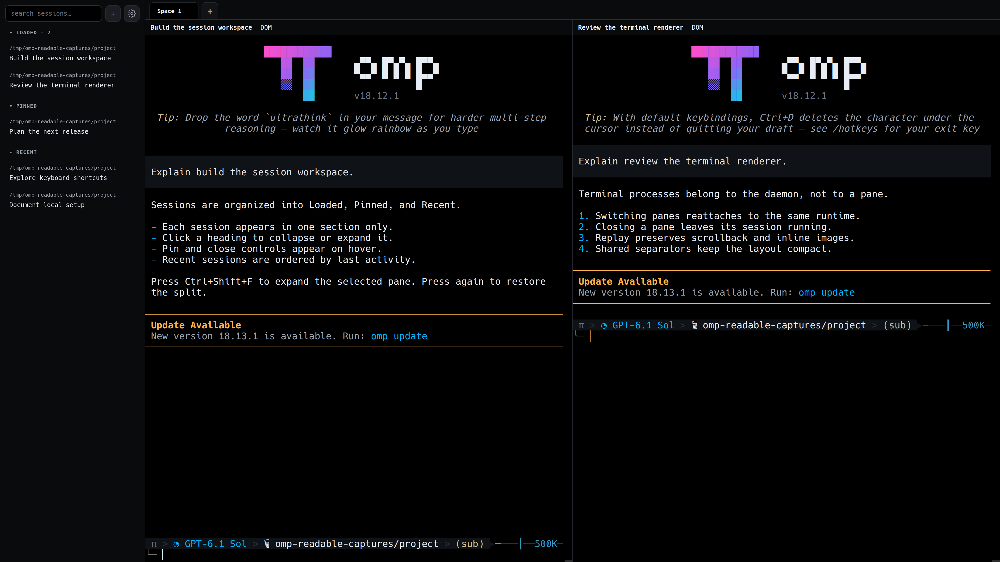
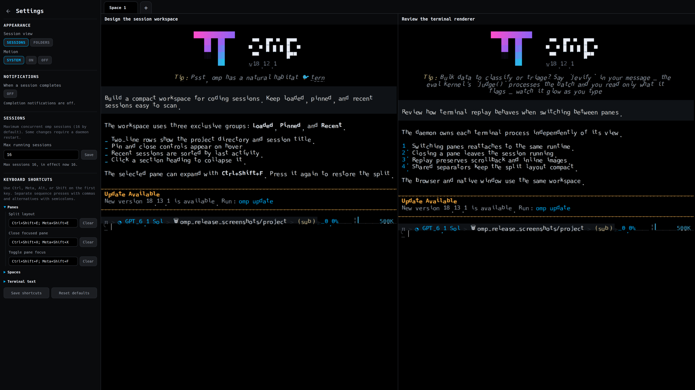

# OMP Desktop

Use [OMP](https://omp.sh) coding sessions in a browser or native desktop window. Linux uses a GTK4/WebKitGTK 6
shell; macOS and Windows retain Tauri. Organize chats into spaces with up to four terminal panes; switch between
live and saved sessions. Closing a pane or window does not stop its session.



## Requirements

- Bun 1.3+, Git and OMP 18.x on `PATH`; run `omp` once to complete provider setup.
- Linux native builds additionally require Rust 1.92+, pkg-config, a C toolchain, and GTK4/WebKitGTK 6 development
  packages; see the [native setup guide](docs/guide.md#native-linux-app). Native macOS/Windows builds use Tauri.

## Quick setup

From the folder where you keep projects:

```sh
git clone https://github.com/cpu23/omp-desktop.git && cd omp-desktop && bun install --frozen-lockfile && bun run start
```

Open <http://127.0.0.1:4180> and select **+** beside the session search. Keep the terminal running.

For a native Linux window, install [Rust 1.92+](https://rustup.rs) and the [system GTK4/WebKitGTK 6 development
packages](docs/guide.md#native-linux-app), then run `bun run app:install` from `omp-desktop/`. Open **OMP Desktop**
from your application menu; the daemon above must remain running.

> The desktop API has no authentication. Keep it on loopback. Setup does not change your OMP configuration.

## Spaces and files

- Click **+** to add a space. Drag a pane or sidebar session onto another space's tab to move/open it there.
- Drag a space tab left or right to reorder workspaces. The active space stays selected, and the order is saved across restarts.
- Drop files onto a pane to insert their paths without submitting. Native drops preserve original paths for all
  file types; file contents are not uploaded.
- Closing a pane only detaches its view. Output continues in the daemon; use the sidebar stop action to end a
  session. See the [guide](docs/guide.md) for configuration, security and native setup details.

## Sessions and settings

- Panes show **Starting session…** while a new session initializes, hiding transient startup protocol text.
  Existing sessions reappear after replay; startup exits and disconnects uncover their output immediately.

- **Loaded → Pinned → Recent:** each session appears only in its highest applicable section. Recent is ordered by
  last conversation activity. Thin, inset dividers separate the groups. Click a section label to collapse or expand it.
- Rows show the directory and title; secondary pin/stop controls appear on hover or keyboard focus.
- Press **Ctrl+Shift+E** (macOS browser: **⌘⇧E**) to cycle split layouts. Press **Ctrl+Shift+F** (**⌘⇧F**) to
  expand the selected pane; press again to restore the split without restarting its session.
- Open the gear beside search for Appearance, Notifications, Sessions, and grouped Keyboard shortcuts.
  Native completion notifications use the installed OMP logo.

<details>
<summary>Settings screenshot — 3840 × 2160</summary>



</details>

## Unreleased

- Replace the Linux GTK3/Tauri shell with a GTK4/WebKitGTK 6 shell using system packages, while retaining Tauri
  on macOS and Windows.
- Require Rust 1.92+, GTK 4.14+, and WebKitGTK 6.0 2.44+ development APIs to build the Linux shell; no private
  WebKit runtime builder or prefix is supported.


## v0.1.4

- Use the installed OMP application logo for native completion notifications instead of the generic system icon.
- Use compact, borderless sidebar rows grouped exclusively into Loaded (with count), Pinned, then Recent by last activity; reveal pin/stop controls on hover or keyboard focus. Start sessions with **+** beside search; remove sidebar collapse and the live-count footer.
- Click Loaded, Pinned, or Recent to collapse or expand that section; labels also support keyboard activation. Keep the sidebar scrollbar gutter stable and directory hover clipping layout-neutral.
- Remove split-pane and sidebar gutters and duplicate outlines; use shared 1px separators with wider invisible resize targets.
- Preserve compact single-line pane headers, remove their bottom border, and match only the hover/focus close and pin icons to the sidebar controls, with synchronized pins.
- Organize settings into Appearance, Notifications, Sessions, and Keyboard shortcuts, with grouped shortcut editors. Replace numbered pane-focus bindings with one configurable toggle that expands the selected pane and restores its split layout.
- Reorder workspace tabs by dragging, with insertion indicators and persisted ordering.
- Ship minified, gzip-compressed, fingerprinted assets without inline source maps; replace browser TTF delivery with WOFF2.
- Drive working indicators with transform animations instead of per-frame JavaScript or changing glyph layout.
- Release exited-runtime capacity and terminal resources; finish explicit stop cleanup before reporting success.
- Bound shared replay/image/snapshot retention and pasted-image storage; preserve ordered replay/live output through WebSocket backpressure.
- Incrementally index appended session costs, coalesce status reads and workspace writes, and pause hidden-client polling.
- Preserve sidebar nodes and offline workspace edits across daemon restarts; generation-fence workspace writes and expose lightweight Mobile viewport/input endpoints.
- Preserve prompt, ID, and path search matches returned by the session index.
- Apply pending-image budgets to parameterized Sixel headers, including headers split across PTY writes.

## CI and local checks

GitHub Actions runs the locked Bun install, typecheck and behavioral tests, then builds/tests and exercises the
GTK4/WebKitGTK 6 Linux shell with an isolated daemon and WebKitWebDriver. macOS and Windows jobs retain coverage
for the Tauri shell. The daemon fixture does not need OMP, provider credentials, or any sibling checkout.

Run the same JavaScript checks locally:

```sh
bun install --frozen-lockfile
bun run check
bun test
bun run scripts/daemon-smoke.ts
```

The broader `bun run smoke` exercises the OMP PTY integration and requires OMP 18.x on `PATH`. For a native Linux
build, install Rust 1.92+ and the [system packages listed in the guide](docs/guide.md#native-linux-app), then run:

```sh
bun run app:build
```

`bun run smoke:native` exercises the real GTK4 shell against isolated daemons and profiles. Its full `--images` run
uses WebDriver for navigation and DOM inspection, and real `xdotool` OS events on a private Xvfb display for
keyboard/pointer scenarios; no JavaScript click or keyboard-event fallback is used. Notification permission, delivery,
click-to-focus, deduplication, UI Off behavior, profile persistence, and same-application activation run in the normal
production binary through AT-SPI inspection and real X11 events, not a controlled automation session. `--input-only`
runs the focused real-PTY input/ACK check. `--notification-only` isolates the normal-mode notification and persistence
scenarios. `--images-only --require-gpu` is a separate current-display WebKit/WebGL image check; run it on Wayland for
Wayland rendering evidence. It does not test keyboard or pointer input. X11 Xvfb input and Wayland rendering are
separate coverage levels; real file-manager drag-and-drop remains distinct manual hardware coverage. Some WebKitGTK
builds mask the WebGL renderer label as “Apple GPU”; the smoke does not treat that label alone as hardware evidence and
corroborates masked NVIDIA rendering with the owned WebKit process's driver mappings/device descriptors and `nvidia-smi` process data.

## Releases and links

[v0.1.4](https://github.com/cpu23/omp-desktop/releases/tag/v0.1.4)
([notes and native-shell requirements](docs/release-v0.1.4.md)) · [all releases](https://github.com/cpu23/omp-desktop/releases).
The release includes source and a Linux x86_64 native-shell archive; Bun, OMP, the daemon checkout, and system GTK/WebKit
libraries are still required. It is not a standalone installer. Build from source for other systems.

[OMP Mobile companion](https://github.com/cpu23/omp-mobile) · [Mobile setup](https://github.com/cpu23/omp-mobile#quick-setup) · [MIT license](LICENSE)
[Initial release notes](docs/release-v0.1.0.md) · [Desktop guide](docs/guide.md)
