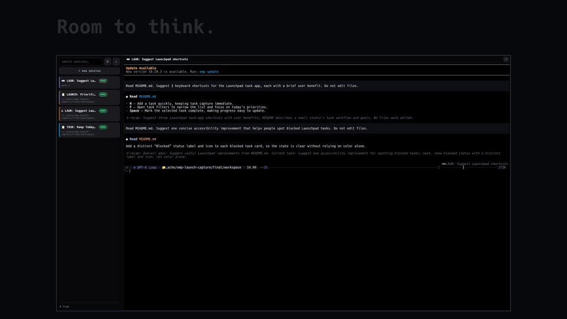

# OMP Desktop

**Your OMP sessions. One workspace.**

Use [OMP](https://omp.sh) in a browser or a native Linux window. Organize chats into spaces using the top tab bar; each space holds up to four terminal panes. Switch between live and saved sessions. Keep sessions running when you close a pane or the window.

<p align="center">
  <a href="https://github.com/cpu23/omp-desktop/releases/download/v0.1.0/launch.mp4"></a>
  <br><a href="https://github.com/cpu23/omp-desktop/releases/download/v0.1.0/launch.mp4">Watch the launch video — 26 seconds, 1080p (MP4)</a> · <a href="docs/media/demo.gif">Open demo GIF</a>
</p>

[Video file in this repository](docs/media/launch.mp4). The GIF above links to the full video with instrumental audio.

<p align="center">
  <a href="docs/images/desktop.png"></a>
  <a href="docs/images/desktop-grid.png"></a>
  <a href="docs/images/desktop-search.png"></a>
</p>

*Real browser footage with Codex GPT-6 Luna: one session → two panes → four panes, session drag-and-drop, a shared theme change, and workspace restoration after reload. The 26-second, 1080p60 film uses fixed framing, minimal headings, tracked drag feedback, and original audio. Source footage is native 1920 × 1080 with disposable demo data—not the native window. Static screenshots use a local test stream. [Capture and rendering details](docs/media/README.md).*

## Requirements

- **Linux** for the native app. The browser client needs a host that supports Bun and PTYs.
- [Bun 1.3+](https://bun.sh), Git, and [OMP 18.x](https://omp.sh) on your `PATH`.
- Run `omp` once. Complete the provider setup.

## Quick setup

Run this command in the folder where you keep your projects:

```sh
git clone https://github.com/cpu23/omp-desktop.git && cd omp-desktop && bun install --frozen-lockfile && bun run start
```

Open **<http://127.0.0.1:4180>**. Select **+ New session**. Keep the terminal open while you use the app.

**Want a native window?** Install [Rust](https://rustup.rs) and the [Linux build packages](docs/guide.md#native-linux-app). Then run this command in a second terminal, from `omp-desktop`:

```sh
bun run app:install
```

Open **OMP Desktop** from your application menu. Keep the first terminal running; the window needs the local daemon.

> Keep port 4180 local. The desktop API has no authentication. Setup does not change your OMP configuration.

## Spaces and files

- Click **+** in the top tab bar to create a space. Each space has its own pane layout and focused chat; spaces restore after reload.
- Drag a pane header onto another space's tab to move its chat, or drag a sidebar session onto a tab to open it there. Switching spaces does not stop their sessions.
- Drop files onto a terminal pane to insert their paths without submitting the message. Native drops preserve the original paths, including video, image and JSON files.
- Closing a pane only detaches the view. Output continues in the daemon and is replayed when reopened; use the sidebar's stop action to terminate a session.

## Releases

**v0.1.0 — Initial source release.** [GitHub release](https://github.com/cpu23/omp-desktop/releases/tag/v0.1.0) · [Launch video (MP4)](https://github.com/cpu23/omp-desktop/releases/download/v0.1.0/launch.mp4) · [Demo GIF](https://github.com/cpu23/omp-desktop/releases/download/v0.1.0/demo.gif) · [Release notes](docs/release-v0.1.0.md).

Source only: no prebuilt binary installers. Follow [Quick setup](#quick-setup); build the optional Linux native window locally using the [Native Linux app guide](docs/guide.md#native-linux-app).

## Upstream & ecosystem

[OMP](https://omp.sh) · [Source](https://github.com/can1357/oh-my-pi) · [Releases](https://github.com/can1357/oh-my-pi/releases) · [Skills](https://omp.sh/docs/skills) · [Plugins](https://omp.sh/docs/plugins) · [Community (Discord)](https://discord.com/invite/4NMW9cdXZa)

[OMP Mobile companion](https://github.com/cpu23/omp-mobile) · [Tauri 2](https://v2.tauri.app/develop/) · [xterm.js](https://xtermjs.org/) · [Bun](https://bun.sh/docs)

## More

[Phone companion](https://github.com/cpu23/omp-mobile) · [Settings and help](docs/guide.md) · [MIT license](LICENSE)

For phone support and session status, keep both repositories in the same parent folder. See the [Mobile setup](https://github.com/cpu23/omp-mobile#quick-setup).
