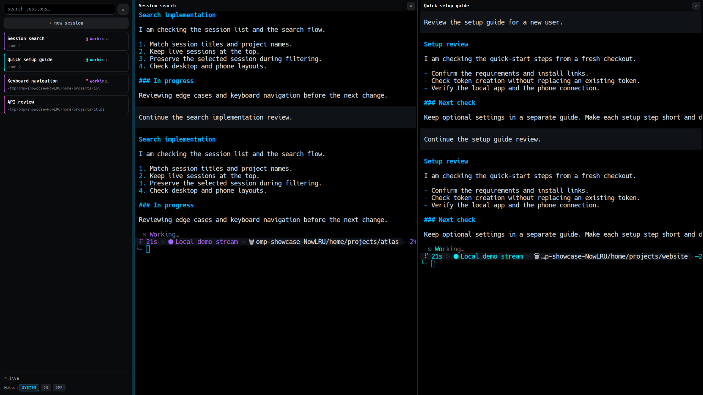
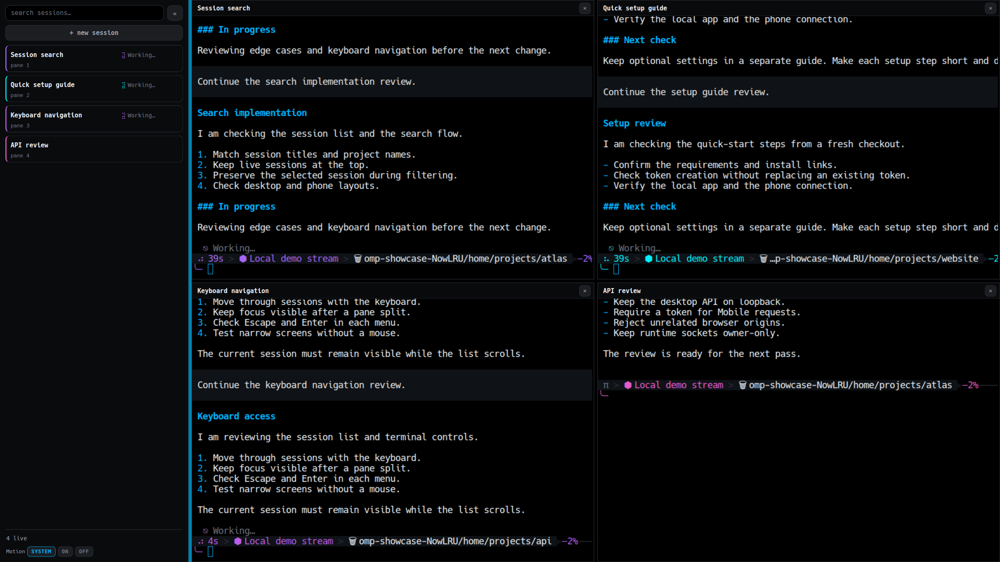
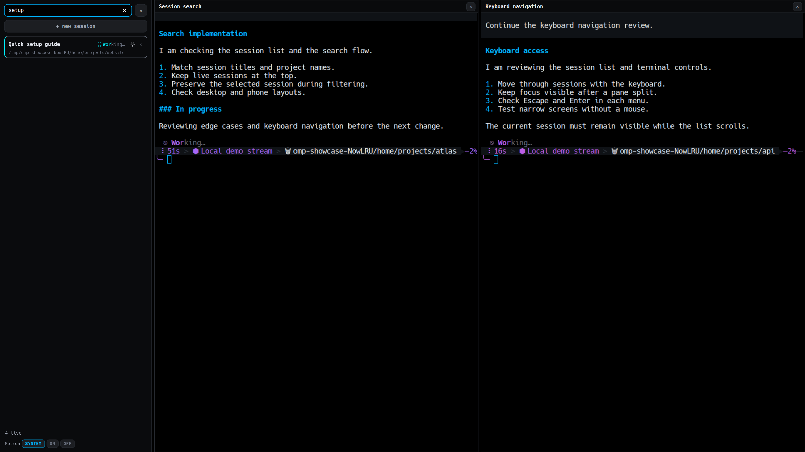

# OMP Desktop

**Your OMP sessions. One workspace.**

Use [OMP](https://omp.sh) in a browser or a native Linux window. Open up to four terminal panes. Switch between live and saved sessions. Keep sessions running when you close the window.



<p align="center">
  <a href="docs/images/desktop-grid.png"></a>
  <a href="docs/images/desktop-search.png"></a>
</p>

*Two panes · Four-pane workspace · Session search. Select an image for full resolution (2400 × 1350). Demo sessions use a local test stream. No personal data is shown.*

## Requirements

- **Linux** for the native app. The browser client needs a host that supports Bun and PTYs.
- [Bun 1.3+](https://bun.sh), Git, and [OMP 18.x](https://omp.sh) on your `PATH`.
- Run `omp` once. Complete the provider setup.

## Quick setup

Run this command in the folder where you keep your projects:

```sh
git clone https://github.com/cpu23/omp-desktop.git && cd omp-desktop && bun install --frozen-lockfile && bun run start
```

Open **<http://127.0.0.1:4180>**. Select **+ New session**. Keep the terminal open while you use the app.

**Want a native window?** Install [Rust](https://rustup.rs) and the [Linux build packages](docs/guide.md#native-linux-app). Then run this command in a second terminal, from `omp-desktop`:

```sh
bun run app:install
```

Open **OMP Desktop** from your application menu. Keep the first terminal running; the window needs the local daemon.

> Keep port 4180 local. The desktop API has no authentication. Setup does not change your OMP configuration.

## More

[Phone companion](https://github.com/cpu23/omp-mobile) · [Settings and help](docs/guide.md) · [MIT license](LICENSE)

For phone support and session status, keep both repositories in the same parent folder. See the [Mobile setup](https://github.com/cpu23/omp-mobile#quick-setup).
